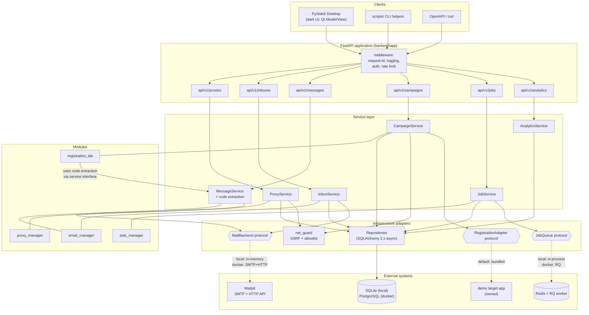
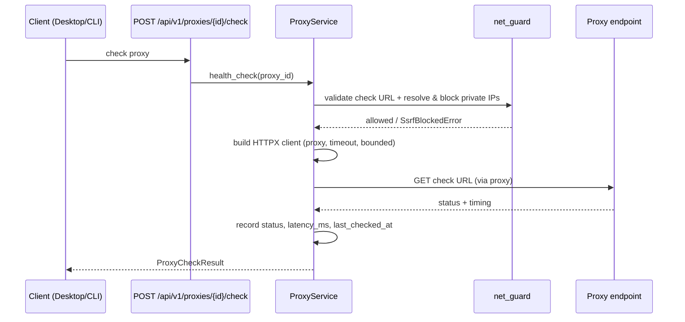
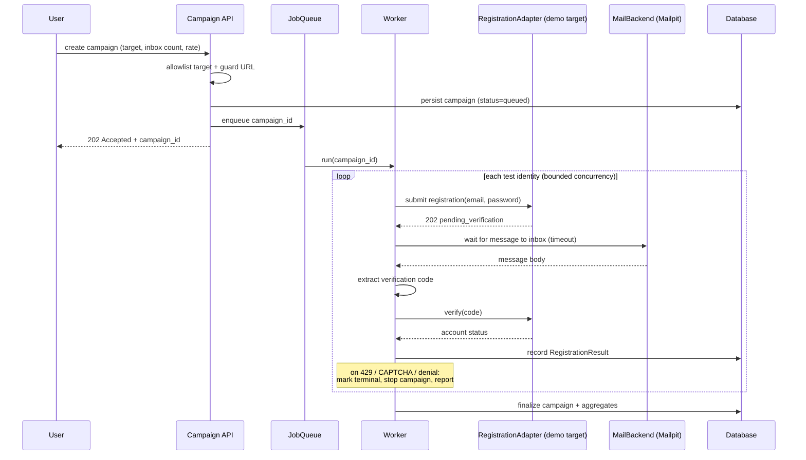

# NEXUS — Architecture

**Status:** Phase 0 baseline. Any change to this document requires a `DECISION_LOG.md` entry.

---

## 1. Architectural style: Modular Monolith

NEXUS is a **single deployable application** composed of **four modules with enforced
boundaries**.

A "modular monolith" means:

- **One process, one database, one deployment** — like a monolith. Simple to run, debug and
  test.
- **Internal boundaries that behave like service edges** — each module has its own models,
  schemas, services and API router, and other modules may only talk to it through its *service
  interface*, never by querying its tables.

Why not microservices? Because the benefits of microservices (independent scaling, independent
deployment, fault isolation) are worthless for a single developer on a laptop, while the costs
(network failure modes, distributed transactions, service discovery, tracing) are paid
immediately. Microservices here would be pure overengineering — see D1.

Why not one flat package? Because then the four modules become one entangled blob within a
month, and the brief's core requirement ("modules evolve independently") is lost.

---

## 2. Layer view

```
+---------------------------------------------------------------------------------+
|  PRESENTATION                                                                    |
|  +-----------------------------+      +--------------------------------------+  |
|  | PySide6 Desktop (desktop/)  |      | REST API (app/api/, auto OpenAPI)     |  |
|  |  - no business logic        |      |  - pydantic request/response models   |  |
|  |  - HTTP client only         |      |  - auth dependency, error mapping     |  |
|  +--------------+--------------+      +------------------+-------------------+  |
+-----------------|----------------------------------------|----------------------+
                  |  HTTP/JSON                             |
+-----------------v----------------------------------------v----------------------+
|  APPLICATION / SERVICE LAYER                                                     |
|  ProxyService | InboxService | CampaignService | JobService | AnalyticsService    |
|  - orchestrates use cases, owns transactions & business rules                    |
|  - depends on repository + adapter INTERFACES, never on concrete infrastructure  |
+---------------------------------------------------------------------------------+
|  DOMAIN                                                                          |
|  SQLAlchemy models, enums, value objects, domain errors                          |
+---------------------------------------------------------------------------------+
|  INFRASTRUCTURE                                                                  |
|  +----------------+ +----------------+ +----------------+ +------------------+  |
|  | Repositories   | | Mail backend   | | Registration   | | Job queue        |  |
|  | (SQLAlchemy)   | | (Mailpit/mem)  | | target adapter | | (inproc / RQ)    |  |
|  +----------------+ +----------------+ +----------------+ +------------------+  |
|  Cross-cutting: config, logging+redaction, net_guard (SSRF), auth, audit         |
+---------------------------------------------------------------------------------+
```

**Dependency rule (enforced by review and by packaging):** arrows point *downward only*.
Infrastructure may not import services; the domain imports nothing from above; the desktop app
imports nothing from `backend/app` at all.

---

## 3. Component diagram



---

## 4. Module boundaries (what each module owns)

| Module | Owns tables | Public service interface | May call |
|---|---|---|---|
| `proxy_manager` | `proxy_sources`, `proxies` | `ProxyService` | repos, `net_guard` |
| `email_manager` | `email_domains`, `inboxes`, `messages` | `InboxService`, `MessageService` | repos, `MailBackend` |
| `registration_lab` | `registration_targets`, `campaigns`, `registration_tests`, `registration_results` | `CampaignService` | repos, `MessageService` (interface), `RegistrationAdapter`, `net_guard` |
| `task_manager` | `background_jobs` | `JobService` | repos, `JobQueue` |
| `core` (shared) | `audit_logs`, `users` | `auth`, `config`, `logging`, `net_guard` | — |

**Rule:** a module may import another module's `service.py` and `schemas.py`; it may **never**
import another module's `models.py`. Need data from another module? Ask its service.

---

## 5. Key runtime flows

### 5.1 Proxy validation (Module A)



Guarantees: the check URL is validated, timeouts are mandatory, concurrency is bounded, and a
proxy failure is recorded as data — it never raises into the request handler.

### 5.2 Registration campaign with email verification (Module C)



### 5.3 Verification-code extraction

Deliberately a **pure function** in `MessageService`: given a message body, return candidate
codes with confidence. No I/O, no network, trivially unit-testable. The campaign flow only ever
consumes codes from inboxes it created for that campaign — it never reads a human's mailbox.

---

## 6. Import-direction rules (the boundary enforcement)

```
app/core/*            -> may import: nothing from app.modules, app.services, app.api
app/models/*          -> may import: app.core (config only)
app/modules/<m>/models.py     -> may import: app.database, app.core
app/modules/<m>/service.py    -> may import: own models, app.core, OTHER modules' service/schemas
app/api/*             -> may import: services + schemas
app/workers/*         -> may import: services
desktop/*             -> may import: httpx, PySide6. NOTHING from backend/app.
```

A future improvement is to enforce this mechanically with `import-linter` in CI (noted as a
Phase 7 candidate). For now it is a review rule, and the packaging of `desktop/` keeps the last
rule physically true.

---

## 7. Concurrency model

| Concern | Mechanism |
|---|---|
| Proxy health checks | `asyncio` + `httpx.AsyncClient`, `asyncio.Semaphore` for bounded concurrency |
| Campaign execution | One background job per campaign; bounded worker concurrency |
| Background jobs | `JobQueue` protocol → `InProcessQueue` (local) or RQ/Redis (docker) |
| Desktop UI | Qt event loop in the main thread; all HTTP calls off-thread (Qt thread pool) or via async worker with signals; **never** block the GUI thread |
| Database | Async engine + session-per-request; one session per job |

Two event loops never mix: the backend runs asyncio, the desktop app runs Qt and talks HTTP.

---

## 8. Configuration profiles

| Setting | `local` (default) | `docker` |
|---|---|---|
| `DATABASE_URL` | `sqlite+aiosqlite:///./nexus.db` | `postgresql+asyncpg://nexus:***@db:5432/nexus` |
| `JOB_QUEUE_BACKEND` | `inprocess` | `rq` |
| `MAIL_BACKEND` | `memory` (or `smtp` if Mailpit is up) | `smtp` |
| `MAILPIT_API_URL` | `http://127.0.0.1:8025` | `http://mailpit:8025` |
| `API_HOST/PORT` | `127.0.0.1:8000` | `0.0.0.0:8000` (container) |

Only environment variables change between profiles — this is what makes D3 safe.

---

## 9. Error handling strategy

| Class | Example | Behaviour |
|---|---|---|
| Domain / validation error | invalid proxy string | HTTP 422 with field detail; never a 500 |
| Blocked by policy | private-IP target URL | HTTP 403 `SsrfBlockedError`, audit-logged |
| Target-side control | 429 / CAPTCHA / access denied | **terminal campaign outcome**, recorded, campaign stopped |
| Transient infra error | DB connection lost | retried with backoff (idempotent jobs only); then 503 |
| Unexpected | anything else | 500 with a `request_id`; full traceback in logs, never in the response |

Exception hierarchy lives in `app/core/exceptions.py` and every class maps to exactly one HTTP
status, so the API layer contains no ad-hoc error translation.

---

## 10. Testing architecture

```
tests/
  unit/          pure functions: parsers, net_guard, code extraction, config validation
  integration/   API + SQLite + in-memory mail backend (httpx ASGITransport, no sockets)
  e2e/           marked 'e2e': real Postgres/Redis/Mailpit + Playwright (Phase 4+)
```

Tier 1 and 2 must pass with **no external services**. That is what makes the suite runnable on
this machine today (see D3/D9).
