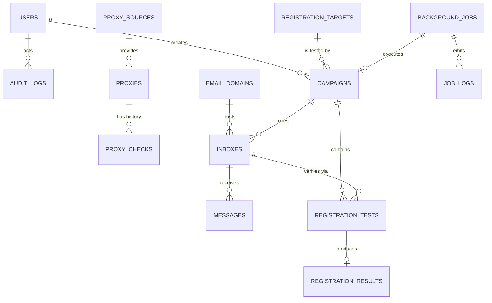

# NEXUS — Database Design

**Status:** Phase 0 design, implemented in Phase 1 (models + initial migration).
**Applies to:** SQLite (local profile) and PostgreSQL (docker profile).

---

## 1. Design principles

1. **Portable types only.** Columns use types valid in both SQLite and PostgreSQL (`String`,
   `Integer`, `Boolean`, `DateTime(timezone=True)`, `Text`, `JSON`). No Postgres-only types in
   the core schema, so the local profile stays a faithful preview of production.
2. **Integer surrogate primary keys.** Simple, index-friendly, and easy to discuss. A UUID
   `public_id` exists where an identifier is exposed in URLs.
3. **Timestamps everywhere.** Every mutable table has `created_at` and `updated_at`
   (`server_default=now()`, `onupdate=now()`).
4. **Status as a constrained string + Python enum.** Readable in the database, validated in
   code; a database `CHECK` constraint would break portability, so validation lives in the
   enum plus a pydantic schema.
5. **No plaintext secrets.** `users.password_hash` is a one-way hash (Argon2/bcrypt).
   Third-party mailbox passwords do not exist in this schema — because NEXUS never has them.
6. **Explicit cascade rules.** Deleting a parent either cascades to owned children or is
   refused (`RESTRICT`); no accidental orphaning.
7. **Foreign keys always indexed** on the child side.

---

## 2. Entity-relationship diagram

---

## 3. Tables

### 3.1 `users`
Local authentication. Single-user by default; role field prepares multi-user without a
migration later.

| Column | Type | Constraints | Notes |
|---|---|---|---|
| `id` | Integer | PK | |
| `username` | String(64) | **unique**, not null, indexed | |
| `password_hash` | String(255) | not null | Argon2/bcrypt hash. **Never** a plaintext password. |
| `role` | String(16) | not null, default `admin` | `admin` \| `viewer` (RBAC hook) |
| `is_active` | Boolean | not null, default true | |
| `last_login_at` | DateTime(tz) | nullable | |
| `created_at` / `updated_at` | DateTime(tz) | not null | |

### 3.2 `proxy_sources` (Module A)
Where a proxy list came from. **Source attribution is a security control**, not metadata: an
untrusted list must be traceable to its origin.

| Column | Type | Constraints | Notes |
|---|---|---|---|
| `id` | Integer | PK | |
| `name` | String(128) | not null | |
| `kind` | String(16) | not null | `manual` \| `file` \| `url` |
| `location` | String(512) | nullable | file path or URL (validated by `net_guard`, never fetched for `file`) |
| `imported_at` | DateTime(tz) | not null | |
| `entry_count` | Integer | not null, default 0 | raw entries seen |
| `accepted_count` | Integer | not null, default 0 | after normalization |
| `rejected_count` | Integer | not null, default 0 | malformed/duplicate |
| `notes` | Text | nullable | |
| `created_at` / `updated_at` | DateTime(tz) | not null | |

### 3.3 `proxies` (Module A)

| Column | Type | Constraints | Notes |
|---|---|---|---|
| `id` | Integer | PK | |
| `source_id` | Integer | FK → `proxy_sources.id`, `ON DELETE SET NULL`, indexed | NULL = manually added |
| `protocol` | String(8) | not null | `http` \| `https` \| `socks5` |
| `host` | String(255) | not null | |
| `port` | Integer | not null | validated 1–65535 |
| `username` | String(128) | nullable | proxy auth user |
| `password_encrypted` | String(512) | nullable | **encrypted at rest**, not hashed (it must be replayed) |
| `status` | String(16) | not null, default `unknown`, indexed | `unknown` \| `healthy` \| `unhealthy` \| `expired` |
| `latency_ms` | Integer | nullable | last successful round-trip |
| `success_count` / `failure_count` | Integer | not null, default 0 | for a reliability ratio |
| `last_checked_at` | DateTime(tz) | nullable | |
| `last_success_at` | DateTime(tz) | nullable | |
| `last_error` | String(512) | nullable | redacted message |
| `is_enabled` | Boolean | not null, default true | soft disable |
| `created_at` / `updated_at` | DateTime(tz) | not null | |

**Constraints**
- `UNIQUE (protocol, host, port, username)` — functional dedupe. (`username` participates because
  two accounts on one endpoint are different proxies; SQLite treats NULLs as distinct, so a
  partial application-level check also runs during import.)
- Index on `(status, latency_ms)` for the "healthy and fast" dashboard query.

**Note on `password_encrypted`:** proxy credentials are replayed to the proxy, so hashing is
impossible. They are encrypted with a key from the environment. If no key is configured,
credential-bearing proxies are rejected rather than stored in the clear.

### 3.4 `proxy_checks` (Module A) — health-check history
Keeps *history* separate from *current state* (`proxies.status`), so reliability is a real
measurement rather than a counter that only ever grows.

| Column | Type | Constraints | Notes |
|---|---|---|---|
| `id` | Integer | PK | |
| `proxy_id` | Integer | FK → `proxies.id`, `ON DELETE CASCADE`, indexed | |
| `checked_at` | DateTime(tz) | not null, indexed | |
| `ok` | Boolean | not null | |
| `latency_ms` | Integer | nullable | |
| `http_status` | Integer | nullable | |
| `error_class` | String(64) | nullable | e.g. `timeout`, `connect_refused`, `tls_error` |
| `error_message` | String(512) | nullable | redacted |

Retention: pruned by a scheduled job (Phase 5) to keep the table bounded.

### 3.5 `email_domains` (Module B)
Reserved domains for test inboxes. `example.test` is reserved by RFC 2606/6761 precisely for
this purpose.

| Column | Type | Constraints | Notes |
|---|---|---|---|
| `id` | Integer | PK | |
| `domain` | String(255) | **unique**, not null | e.g. `example.test` |
| `is_reserved` | Boolean | not null, default true | must stay true for non-owned domains |
| `is_active` | Boolean | not null, default true | |
| `description` | String(255) | nullable | |
| `created_at` / `updated_at` | DateTime(tz) | not null | |

A guard rejects configuring a domain that is not RFC-reserved **and** not explicitly marked as
owner-verified. This is the mechanism behind "no third-party mailbox creation".

### 3.6 `inboxes` (Module B)

| Column | Type | Constraints | Notes |
|---|---|---|---|
| `id` | Integer | PK | |
| `public_id` | String(36) | **unique**, not null, indexed | UUID exposed in the API |
| `domain_id` | Integer | FK → `email_domains.id`, `ON DELETE RESTRICT`, indexed | |
| `local_part` | String(64) | not null | random alias |
| `address` | String(320) | **unique**, not null, indexed | `local_part@domain`, denormalized for lookups |
| `label` | String(128) | nullable | human note, e.g. `campaign-42` |
| `status` | String(16) | not null, default `active`, indexed | `active` \| `expired` \| `archived` |
| `expires_at` | DateTime(tz) | nullable, indexed | cleanup job target |
| `campaign_id` | Integer | FK → `campaigns.id`, `ON DELETE SET NULL`, nullable, indexed | set when campaign-owned |
| `message_count` | Integer | not null, default 0 | avoids a COUNT on the hot path |
| `last_message_at` | DateTime(tz) | nullable | |
| `created_at` / `updated_at` | DateTime(tz) | not null | |

**Constraint:** `UNIQUE (domain_id, local_part)` — same alias cannot exist twice on a domain.

### 3.7 `messages` (Module B)

| Column | Type | Constraints | Notes |
|---|---|---|---|
| `id` | Integer | PK | |
| `inbox_id` | Integer | FK → `inboxes.id`, `ON DELETE CASCADE`, indexed | |
| `backend_message_id` | String(255) | nullable, indexed | Mailpit's ID, for reconciliation |
| `sender` | String(320) | not null | |
| `recipient` | String(320) | not null | |
| `subject` | String(512) | nullable | |
| `body_text` | Text | nullable | |
| `body_html` | Text | nullable | stored, never rendered in the UI (avoids HTML injection) |
| `received_at` | DateTime(tz) | not null, indexed | |
| `size_bytes` | Integer | nullable | |
| `extracted_code` | String(32) | nullable | cached extraction result |
| `extraction_confidence` | Float | nullable | 0.0–1.0 |
| `headers_json` | JSON | nullable | selected headers only (safety: size-capped) |
| `created_at` / `updated_at` | DateTime(tz) | not null | |

**Constraint:** `UNIQUE (inbox_id, backend_message_id)` — makes message ingestion idempotent, so
a retried poll cannot duplicate messages.

### 3.8 `registration_targets` (Module C) — the allowlist, persisted

| Column | Type | Constraints | Notes |
|---|---|---|---|
| `id` | Integer | PK | |
| `name` | String(128) | not null | e.g. `bundled demo app` |
| `base_url` | String(512) | **unique**, not null | must pass `net_guard` + allowlist at write time |
| `kind` | String(16) | not null | `demo` \| `api` \| `ui` |
| `adapter_name` | String(64) | not null | key into the adapter registry |
| `is_authorized` | Boolean | not null, default false | **must be explicitly true**, never inferred |
| `authorization_note` | Text | nullable | who authorized it and when — required when `is_authorized` |
| `is_active` | Boolean | not null, default true | |
| `created_at` / `updated_at` | DateTime(tz) | not null | |

**Rule:** `CampaignService` refuses to create a campaign for a target that is not
`is_authorized = true` *and* allowlisted. Two independent gates for the same property, on
purpose.

### 3.9 `campaigns` (Module C)

| Column | Type | Constraints | Notes |
|---|---|---|---|
| `id` | Integer | PK | |
| `public_id` | String(36) | unique, not null, indexed | |
| `name` | String(200) | not null | |
| `target_id` | Integer | FK → `registration_targets.id`, `ON DELETE RESTRICT`, indexed | |
| `status` | String(16) | not null, default `queued`, indexed | `queued` \| `running` \| `completed` \| `failed` \| `cancelled` \| `stopped_by_target` |
| `total_tests` | Integer | not null, default 0 | |
| `completed_tests` | Integer | not null, default 0 | progress numerator |
| `succeeded_tests` / `failed_tests` | Integer | not null, default 0 | |
| `concurrency` | Integer | not null, default 2 | conservative default |
| `rate_limit_per_minute` | Integer | not null, default 20 | fixed, configurable, never adaptive |
| `scenario_config_json` | JSON | nullable | scenario parameters |
| `created_by` | Integer | FK → `users.id`, `ON DELETE SET NULL` | |
| `job_id` | Integer | FK → `background_jobs.id`, `ON DELETE SET NULL` | |
| `started_at` / `finished_at` | DateTime(tz) | nullable | |
| `stop_reason` | String(255) | nullable | populated for `stopped_by_target` / `failed` |
| `created_at` / `updated_at` | DateTime(tz) | not null | |

### 3.10 `registration_tests` (Module C) — one synthetic identity

| Column | Type | Constraints | Notes |
|---|---|---|---|
| `id` | Integer | PK | |
| `campaign_id` | Integer | FK → `campaigns.id`, `ON DELETE CASCADE`, indexed | |
| `inbox_id` | Integer | FK → `inboxes.id`, `ON DELETE SET NULL`, indexed | inbox used for verification |
| `email` | String(320) | not null | synthetic identity |
| `password_ref` | String(128) | nullable | **reference to a generated secret**, not the secret |
| `status` | String(24) | not null, default `pending`, indexed | `pending` \| `submitted` \| `awaiting_email` \| `verified` \| `active` \| `failed` \| `blocked_by_target` |
| `attempt_count` | Integer | not null, default 0 | |
| `started_at` / `finished_at` | DateTime(tz) | nullable | |
| `error_code` | String(64) | nullable | classified failure |
| `error_message` | String(512) | nullable | redacted |
| `created_at` / `updated_at` | DateTime(tz) | not null | |

**Idempotency:** `UNIQUE (campaign_id, email)` — re-running a campaign cannot silently create a
second test for the same identity.

### 3.11 `registration_results` (Module C) — analyzed outcome

| Column | Type | Constraints | Notes |
|---|---|---|---|
| `id` | Integer | PK | |
| `test_id` | Integer | FK → `registration_tests.id`, `ON DELETE CASCADE`, **unique** | 1:1 with test |
| `outcome` | String(24) | not null | `success` \| `verification_failed` \| `email_timeout` \| `validation_error` \| `rate_limited` \| `captcha_encountered` \| `access_denied` \| `unexpected_error` |
| `verification_code` | String(32) | nullable | captured for debugging a failing flow |
| `code_extraction_confidence` | Float | nullable | |
| `account_status` | String(32) | nullable | as reported by the target adapter |
| `steps_json` | JSON | nullable | ordered step timings — the "why" behind a failure |
| `duration_ms` | Integer | nullable | |
| `created_at` / `updated_at` | DateTime(tz) | not null | |

`outcome` distinguishes **product defects** (`verification_failed`, `validation_error`) from
**stopping conditions** (`rate_limited`, `captcha_encountered`, `access_denied`). Dashboards
must not mix them: one is a bug report, the other is a boundary the tool respects.

### 3.12 `background_jobs` (Module D)

| Column | Type | Constraints | Notes |
|---|---|---|---|
| `id` | Integer | PK | |
| `public_id` | String(36) | unique, not null, indexed | |
| `job_type` | String(64) | not null, indexed | e.g. `proxy.check_batch`, `campaign.run` |
| `status` | String(16) | not null, default `queued`, indexed | `queued` \| `running` \| `completed` \| `failed` \| `cancelled` |
| `progress_current` / `progress_total` | Integer | not null, default 0 | |
| `payload_json` | JSON | nullable | **secrets redacted before storage** |
| `result_json` | JSON | nullable | |
| `error_message` | String(1024) | nullable | |
| `attempts` | Integer | not null, default 0 | |
| `idempotency_key` | String(128) | nullable, **unique** | prevents duplicate execution on retry |
| `cancel_requested` | Boolean | not null, default false | cooperative cancellation flag |
| `queued_at` | DateTime(tz) | not null | |
| `started_at` / `finished_at` | DateTime(tz) | nullable | |
| `duration_ms` | Integer | nullable | |
| `created_at` / `updated_at` | DateTime(tz) | not null | |

### 3.13 `job_logs` (Module D)

| Column | Type | Constraints | Notes |
|---|---|---|---|
| `id` | Integer | PK | |
| `job_id` | Integer | FK → `background_jobs.id`, `ON DELETE CASCADE`, indexed | |
| `level` | String(10) | not null | `debug` \| `info` \| `warning` \| `error` |
| `message` | Text | not null | redacted |
| `context_json` | JSON | nullable | |
| `created_at` | DateTime(tz) | not null, indexed | |

### 3.14 `audit_logs` (cross-cutting)

| Column | Type | Constraints | Notes |
|---|---|---|---|
| `id` | Integer | PK | |
| `user_id` | Integer | FK → `users.id`, `ON DELETE SET NULL`, indexed | |
| `action` | String(64) | not null, indexed | e.g. `proxy.import`, `target.authorize`, `campaign.start` |
| `entity_type` | String(64) | nullable | |
| `entity_id` | String(64) | nullable | |
| `outcome` | String(16) | not null | `success` \| `denied` \| `error` |
| `detail_json` | JSON | nullable | redacted; **never** contains secrets or credentials |
| `client_ip` | String(64) | nullable | |
| `request_id` | String(64) | nullable, indexed | correlates with application logs |
| `created_at` | DateTime(tz) | not null, indexed | |

Audit rows are append-only by convention: no update or delete code path exists.

---

## 4. Index summary (the queries that must be fast)

| Query | Index used |
|---|---|
| Dashboard proxy counts by status | `proxies(status)` |
| Fast healthy proxies | `proxies(status, latency_ms)` |
| Proxy lookup by endpoint during import dedupe | `UNIQUE(protocol, host, port, username)` |
| Recent checks for one proxy | `proxy_checks(proxy_id, checked_at)` |
| Inbox by address (SMTP routing) | `UNIQUE(inboxes.address)` |
| Expired inbox cleanup | `inboxes(status, expires_at)` |
| Messages of an inbox, newest first | `messages(inbox_id, received_at)` |
| Idempotent message ingestion | `UNIQUE(messages.inbox_id, backend_message_id)` |
| Campaign progress polling | `campaigns(status)` |
| Test listing for a campaign | `registration_tests(campaign_id, status)` |
| Duplicate-test prevention | `UNIQUE(registration_tests.campaign_id, email)` |
| Job monitor "running now" | `background_jobs(status, queued_at)` |
| Retry dedupe | `UNIQUE(background_jobs.idempotency_key)` |
| Audit trail for an entity | `audit_logs(entity_type, entity_id)` |

---

## 5. Migration strategy (Alembic)

- `alembic/versions/0001_initial.py` creates the full Phase-1 schema.
- Autogenerate is used to draft revisions, then **reviewed by hand** — autogenerate misses
  constraint changes and index renames.
- Every schema change requires a revision; editing an applied migration is forbidden.
- Downgrades are written for the tables we can safely drop; where data loss is inherent, the
  downgrade raises an explicit error instead of silently destroying data.
- SQLite limitation: `ALTER COLUMN` is not supported, so future SQLite alterations use
  Alembic's `batch_alter_table` (copy-and-move). Postgres uses normal DDL.

---

## 6. Deliberate omissions (and why)

| Not included | Reason |
|---|---|
| Table for third-party mailbox credentials | NEXUS never holds them — by design, see `PROJECT_OVERVIEW.md` §2. |
| CAPTCHA-solving / cookie-farming tables | Functionality does not exist; a schema for it would imply intent. |
| Proxy↔campaign join table | Registration must not use the proxy pool (D8). Absence is the enforcement. |
| Soft-delete column on every table | Only where the product needs history (`proxies`, `inboxes`); blanket soft delete complicates every query for no benefit. |
| Multi-tenant `organization_id` | Single-user local-first product; adding tenancy now is speculative complexity. |
